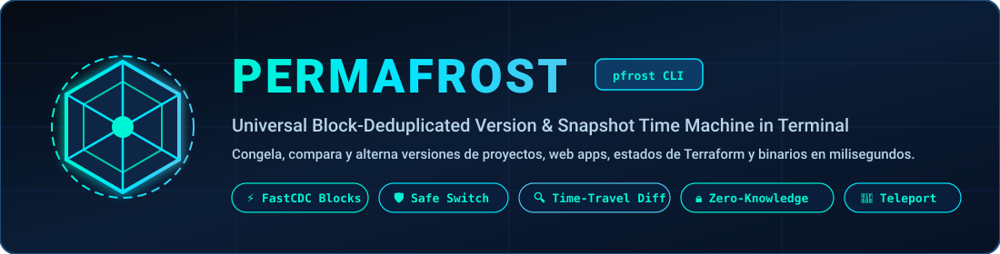
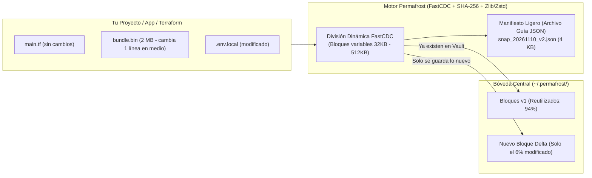

<div align="center">
  

  <br />

  [](https://github.com/amglogicalis/permafrost/actions)
  [](https://go.dev/)
  [](https://github.com/amglogicalis/permafrost/releases)
  [](#4--encriptaci%C3%B3n-zero-knowledge-aes-256-gcm)
  [](LICENSE)

  <p align="center">
    <b>Congela, compara, restaura y teletransporta cualquier proyecto, web app, stack de Terraform o binario en milisegundos.</b><br />
    Impulsado por <b>Content-Defined Chunking (FastCDC)</b>, una interfaz visual interactiva en terminal (<b>TUI</b>) y módulos 100% activables, desactivables y transparentes.
  </p>

  <p align="center">
    <a href="#-instalación-en-1-línea">Instalación en 1 Línea</a> •
    <a href="#-demo-interactiva-tui--cli">Demo Visual</a> •
    <a href="#-cómo-funciona-la-deduplicación-por-bloques">Arquitectura FastCDC</a> •
    <a href="#-módulos-activables-desactivables-y-transparentes">Módulos (ON/OFF)</a> •
    <a href="#-guía-rápida-de-comandos-cli">Referencia CLI</a>
  </p>
</div>

---

## 🎬 Demo Interactiva (TUI & CLI)

<div align="center">
  
</div>

---

## ❄️ ¿Qué es Permafrost (`pfrost`) y por qué existe?

Cuando desarrollas aplicaciones web, infraestructuras con **Terraform**, herramientas o prototipos, **`git` solo guarda el código fuente**. Pero tu entorno real de trabajo incluye mucho más:
* Archivos `.env` y secretos locales que no puedes subir a Git.
* Estados de infraestructura (`terraform.tfstate`, `.terraform/`), bases de datos locales (`SQLite`, dumps) y compilados/binarios pesados.
* Versiones concretas de ejecutables CLI (`terraform`, `kubectl`, `node`, tus propios binarios).

**Permafrost (`pfrost`)** es una **máquina del tiempo universal en tu terminal**:
1. **No duplica archivos enteros:** Divide los archivos en bloques inteligentes según su contenido (**FastCDC**), los comprime y guarda en tu bóveda central (`~/.permafrost`) **únicamente los fragmentos que han cambiado**, junto con un **Manifiesto (archivo guía)** de apenas unos Kilobytes.
2. **Hot-Swap en milisegundos:** Al cambiar de la versión `v2.0` a la `v1.0`, Permafrost comprueba las huellas `SHA-256` en disco, **no toca los archivos que ya coinciden (0 I/O)** y reconstruye únicamente los bloques diferentes.
3. **Transparencia y Control Total:** Todas sus funciones avanzadas (**Safe Switch**, **Hooks**, **Time-Travel Diff**, **Zero-Knowledge Encryption**, **Teleport** y **Global Binaries**) se pueden activar `[ON]` o desactivar `[OFF]` en cualquier momento desde el menú visual o por comandos, dejando rastro auditable en `~/.permafrost/audit.log`.

| Característica | Copias manuales (`.zip`) | `git` / `git stash` | **Permafrost (`pfrost`)** |
| :--- | :---: | :---: | :---: |
| **Espacio ocupado por 20 versiones de 500 MB** | ~10 GB | Falla con binarios grandes | **~190 MB (Deduplicación FastCDC)** |
| **Incluye `.env`, `tfstate`, DBs locales y binarios** | ✅ Sí | ❌ No (`.gitignore`) | **✅ Sí (100% del estado real)** |
| **Velocidad de cambio entre versiones (Hot-Swap)** | Lento (descomprimir todo) | Conflictos de ramas/merge | **Milisegundos (solo escribe el delta)** |
| **Interfaz Visual en Terminal (TUI)** | ❌ No | ❌ No | **✅ Sí (4 paneles interactivos)** |
| **Restaurar un único archivo del pasado (`Cherry-Pick`)** | Manual | Complejo | **✅ 1 tecla en la TUI o `pfrost pick`** |
| **Sincronización Cloud Cifrada (GitHub Releases / S3)** | ❌ No | ❌ Sin secretos/binarios | **✅ Chunking `<2GB` + Zero-Knowledge** |

---

## ⚡ Instalación en 1 Línea

### Windows (PowerShell)
```powershell
irm https://raw.githubusercontent.com/amglogicalis/permafrost/main/scripts/install.ps1 | iex
```

### Linux & macOS (Bash / Zsh / POSIX sh)
```bash
curl -fsSL https://raw.githubusercontent.com/amglogicalis/permafrost/main/scripts/install.sh | sh
```

### Vía NPM / Node.js (Multiplataforma)
```bash
# Instalar globalmente
npm install -g pfrost

# O ejecutar directamente sin instalar
npx pfrost
```

### Vía Go Toolchain
```bash
go install github.com/amglogicalis/permafrost/cmd/pfrost@latest
```

---

## 🧠 ¿Cómo funciona la Deduplicación por Bloques?



1. **Content-Defined Chunking (FastCDC):** A diferencia de partir archivos en trozos fijos (donde insertar 1 byte al principio desplaza todos los bytes siguientes), Permafrost usa una ventana rodante matemática (*Gear Hash*) para cortar los bloques según el propio contenido. Si modificas 50 bytes en medio de un binario de 100 MB, **el 99% de los bloques siguen teniendo exactamente el mismo hash** y no ocupan ni un solo byte extra.
2. **El Archivo Guía (Manifiesto):** Cada versión congelada genera un pequeño archivo JSON en `~/.permafrost/store/manifests/` que contiene la receta exacta de qué bloques componen cada archivo, sus permisos y fechas.
3. **Recolector de Basura (`pfrost gc`):** Cuando eliminas un snapshot antiguo, Permafrost analiza qué bloques siguen siendo referenciados por otras versiones y libera únicamente los bloques huérfanos.

---

## 🖥️ Interfaz Interactiva Visual (TUI)

Ejecuta simplemente **`pfrost`** (sin argumentos) en cualquier carpeta para abrir la interfaz interactiva a pantalla completa:

```bash
pfrost
```

* **`[1] ❄ Versiones & Snapshots`:** Navega por tus proyectos registrados y su línea temporal de versiones. Pulsa `f` para congelar una nueva versión, `Enter` o `s` para hacer *Hot-Swap* instantáneo, `x` para eliminar una versión o `g` para limpiar bloques huérfanos.
* **`[2] 🔍 Time-Travel Diff & Cherry-Pick`:** Inspecciona visualmente qué archivos se crearon (`🟢 +`), cuáles cambiaron (`🟡 ~`) y cuáles se eliminaron (`🔴 -`). Marca archivos individuales con `Espacio` (`[✓]`) y pulsa `r` para **traer solo esos archivos del pasado** sin alterar el resto de tu carpeta.
* **`[3] ⚙ Feature Center (ON/OFF)`:** Activa o desactiva cualquiera de los 6 módulos de Permafrost en tiempo real pulsando `Espacio` o `Enter`.
* **`[4] 🛡 Auditoría & Vault`:** Consulta el ahorro global de espacio físico vs. lógico y revisa el registro transparente `~/.permafrost/audit.log`.

> [!TIP]
> También puedes renderizar cualquier panel directamente en la salida estándar sin abrir el modo interactivo usando:
> `pfrost dashboard`, `pfrost dashboard --diff`, `pfrost dashboard --features` o `pfrost dashboard --audit`.

---

## 🧩 Módulos Activables, Desactivables y Transparentes

Todos los módulos pueden consultarse y conmutarse en cualquier momento desde la pestaña **`[3] Feature Center`** de la TUI o mediante CLI:

```bash
# Ver el estado actual [ON] / [OFF] de todos los módulos
pfrost features

# Activar o desactivar cualquier módulo de forma transparente
pfrost feature safe_switch on
pfrost feature hooks off
```

---

### 1. 🛡 Safe Switch (Auto-Stash Inteligente)

Evita perder cambios accidentales cuando saltas de una versión a otra.
* **Cuando está `[ON]`:** Antes de cambiar de versión, `pfrost` escanea tu carpeta en milisegundos. Si detecta archivos modificados respecto a la versión activa, **crea automáticamente un micro-snapshot de seguridad (`auto-stash`)** en `~/.permafrost/stash/` antes de aplicar la versión destino.
* **Cuando está `[OFF]`:** Informa en pantalla (`ℹ Safe Switch [OFF]`) y realiza el cambio directamente.

```bash
pfrost safeswitch status                           # Ver estado [ON/OFF] y lista de auto-stashes
pfrost safeswitch on | off                         # Activar o desactivar Safe Switch
pfrost safeswitch restore <stash-id|tag>           # Restaurar cambios guardados por Safe Switch
pfrost safeswitch promote <stash-id> v2.1-rescued  # Convertir un auto-stash en versión permanente
pfrost safeswitch clear                            # Limpiar todos los auto-stashes del proyecto
```

---

### 2. ⚡ Hooks Pre-Congelado y Post-Cambio (`.permafrost.yaml`)

Automatiza tareas alrededor de tus versiones (por ejemplo, hacer un volcado de tu base de datos local antes de congelar o reiniciar contenedores al cambiar de versión).
* **Seguridad y Transparencia SHA-256:** Permafrost nunca ejecuta un archivo `.permafrost.yaml` desconocido a ciegas. Calcula su huella `SHA-256` y verifica que esté autorizada en `~/.permafrost/trusted_hooks.json`. Si el archivo cambia, te muestra qué comandos contiene y te pide autorizarlo con `pfrost hooks trust`.

```yaml
# .permafrost.yaml en la raíz de tu proyecto
enabled: true

hooks:
  pre_freeze:
    - echo "[Hook] Exportando base de datos local antes de congelar..."
  post_freeze:
    - echo "[Hook] Snapshot completado."
  pre_switch:
    - echo "[Hook] Deteniendo servicios locales..."
  post_switch:
    - echo "[Hook] Entorno restaurado y listo."
```

```bash
pfrost hooks init             # Crea una plantilla .permafrost.yaml y la autoriza automáticamente
pfrost hooks status           # Muestra estado [ON/OFF], huella SHA-256 y comandos configurados
pfrost hooks trust | revoke   # Autoriza o revoca permisos de ejecución para .permafrost.yaml
pfrost hooks on | off         # Activa o desactiva globalmente la ejecución de Hooks
pfrost hooks run pre_freeze   # Prueba manualmente una etapa de hooks viendo su salida en vivo
```

---

### 3. 🔍 Time-Travel Diff Visual & Cherry-Pick Selectivo

Compara cualquier versión con tu carpeta actual o compara dos versiones entre sí antes de cambiar:

```bash
# Comparar versión activa con los cambios actuales de tu carpeta
pfrost diff

# Ver qué ocurrirá si cambias de tu carpeta actual a la versión v1.0
pfrost diff v1.0

# Comparar dos versiones congeladas entre sí
pfrost diff v1.0 v2.0

# 🍒 CHERRY-PICK: Restaurar SOLO el archivo .env y la carpeta infra/ de la v1.0 sin tocar nada más
pfrost pick v1.0 .env infra/
```

---

### 4. 🔒 Encriptación Zero-Knowledge (`AES-256-GCM`)

Como tus snapshots de Permafrost contienen archivos sensibles (`.env`, `terraform.tfstate`, claves locales), todos los paquetes que se suben a la nube o se comparten por Teleport pueden cifrarse localmente con **Zero-Knowledge**:
* Derivación de clave mediante **PBKDF2-HMAC-SHA256 (100,000 iteraciones)** + salt aleatorio de 16 bytes.
* Cifrado autenticado **AES-256-GCM** con cabecera mágica verificada `PFZK01`. Ni GitHub, ni AWS S3, ni nadie sin tu clave puede leer un solo byte ni alterar un solo bit.

```bash
pfrost crypto status                  # Ver estado [ON/OFF] y huella de verificación
pfrost crypto keygen                  # Generar una Recovery Key de alta entropía (ej. pfk_8a92...)
pfrost crypto on | off                # Activar o desactivar el cifrado Zero-Knowledge
pfrost crypto inspect paquete.pfchunk # Inspeccionar si un archivo está cifrado (🔒 PFZK01) o en claro (🔓)
```

---

### 5. ☁️ Sincronización Cloud Multi-Backend (`GitHub Releases` & `S3/R2`)

Convierte un repositorio privado de **GitHub Releases** o un bucket **S3 / Cloudflare R2 / MinIO** en tu bóveda en la nube personal o de equipo:
* **Chunking Automático (`<2GB`):** Permafrost divide automáticamente los paquetes grandes en fragmentos numerados (`part_001.pfchunk`, `part_002.pfchunk`, ..., por defecto de 100 MB, muy por debajo del límite de 2 GB por archivo de GitHub Releases) acompañados de un índice `bundle_index.json` con verificación `SHA-256` por fragmento.

```bash
# Opción A: Configurar un repositorio privado de GitHub Releases como almacenamiento Cloud
pfrost cloud setup github amglogicalis/permafrost-vault

# Opción B: Configurar un bucket compatible con S3 / Cloudflare R2 / MinIO
pfrost cloud setup s3 https://<account>.r2.cloudflarestorage.com mi-bucket auto

# Subir una versión cifrada con Zero-Knowledge a la nube
pfrost cloud push v1.0 --key pfk_tu_clave_secreta

# Descargar y reconstruir una versión desde cualquier ordenador
pfrost cloud pull pfrost-mi-proyecto-v1.0 --key pfk_tu_clave_secreta -p ./restaurado
```

---

### 6. 🚀 Teleport (Compartir un Entorno Exacto en 1 Comando)

¿Un compañero de equipo o cliente necesita reproducir exactamente el estado de tu proyecto (con dependencias, `.env` y configuración) en su máquina?

```bash
# 1. Empaquetar y cifrar el estado actual en una cápsula Teleport con caducidad (TTL 24h)
pfrost teleport send v1.0 --key pfk_clave_compartida
# ➔ Genera el código: tp_9f82a1c4

# 2. Recibir y reconstruir el entorno exacto en otra carpeta o máquina
pfrost teleport receive tp_9f82a1c4 ./entorno-clonado --key pfk_clave_compartida

# 3. Auditar y revocar cápsulas Teleport activas en cualquier momento
pfrost teleport list
pfrost teleport revoke tp_9f82a1c4
pfrost teleport on | off
```

---

### 7. 🧰 Modo Permafrost Global Binaries (`~/.permafrost/bin`)

Gestiona versiones de herramientas ejecutables sueltas (`terraform`, `kubectl`, `hugo`, `node`, o tus propios binarios compilados) usando el mismo motor de deduplicación FastCDC:

```bash
# Añadir ~/.permafrost/bin a tu PATH (muestra el comando exacto para tu shell)
pfrost bin path

# Registrar y congelar distintas versiones de un ejecutable
pfrost bin add terraform ./terraform-1.7.0.exe v1.7.0 "Versión estable legacy"
pfrost bin add terraform ./terraform-1.8.0.exe v1.8.0 "Versión actual producción"

# Alternar instantáneamente entre versiones en ~/.permafrost/bin
pfrost bin use terraform v1.7.0
pfrost bin use terraform v1.8.0

# Ver catálogo de binarios y versiones gestionadas
pfrost bin list
pfrost bin on | off
```

---

## 📋 Guía Rápida de Comandos CLI

| Comando | Descripción |
| :--- | :--- |
| `pfrost` | Abre la interfaz interactiva visual (**TUI**) a pantalla completa |
| `pfrost dashboard [--diff\|--features\|--audit]` | Renderiza los paneles visuales directamente en la terminal |
| `pfrost init [ruta] [nombre]` | Registra un proyecto o carpeta en `~/.permafrost` |
| `pfrost freeze [tag] [-m "mensaje"]` | Congela el estado actual usando deduplicación FastCDC + compresión |
| `pfrost switch <tag\|id> [--no-safe-switch]` | Cambia en milisegundos a la versión indicada (*Hot-Swap*) |
| `pfrost diff [v1] [v2] [-a]` | Muestra el *Time-Travel Diff* en color con deltas de tamaño |
| `pfrost pick <tag\|id> <archivo1> [archivo2...]` | Restaura selectivamente archivos o subcarpetas (*Cherry-Pick*) |
| `pfrost list` | Lista todas las versiones congeladas del proyecto actual |
| `pfrost status` | Muestra el ahorro global por deduplicación y proyectos registrados |
| `pfrost feature [modulo] [on\|off]` | Lista o activa/desactiva cualquiera de los 6 módulos |
| `pfrost safeswitch [status\|on\|off\|restore\|promote\|clear]` | Gestiona el módulo *Safe Switch* y sus auto-stashes |
| `pfrost hooks [status\|init\|trust\|revoke\|on\|off\|run]` | Gestiona hooks de `.permafrost.yaml` con firma `SHA-256` |
| `pfrost bin [status\|add\|use\|remove\|path\|on\|off]` | Gestiona ejecutables globales en `~/.permafrost/bin` |
| `pfrost crypto [status\|keygen\|inspect\|on\|off]` | Gestiona el cifrado Zero-Knowledge `AES-256-GCM` |
| `pfrost cloud [status\|setup\|push\|pull\|list]` | Sincroniza versiones con GitHub Releases (`<2GB` chunks) o S3/R2 |
| `pfrost teleport [status\|send\|receive\|revoke\|on\|off]` | Crea, recibe o revoca cápsulas efímeras *Teleport* |
| `pfrost gc` | Ejecuta el recolector de basura para limpiar bloques huérfanos |
| `pfrost audit` | Muestra el registro transparente de operaciones (`audit.log`) |

---

## 🛠️ Desarrollo y Ejecución de Tests

```bash
# Clonar el repositorio
git clone https://github.com/amglogicalis/permafrost.git
cd permafrost

# Ejecutar la batería completa de tests unitarios y de integración
go test -v ./...

# Compilar el binario pfrost
go build -o pfrost ./cmd/pfrost
```

---

## 📄 Licencia

Distribuido bajo la licencia **MIT**. Consulta el archivo [LICENSE](LICENSE) para más información.
